<p>
<picture>
  <source media="(prefers-color-scheme: dark)" srcset="docs/readme/title-dark.svg">
  
</picture>
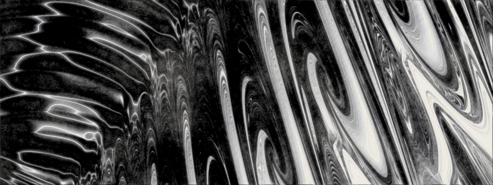
</p>

*Where the future frays at the edges, outcomes braid and unbraid at the threshold where almost becomes inevitable.*

---

You are looking through a slice of every possible beginning of the three-body problem. Each point is a complete starting configuration (three masses, their positions and velocities), followed forward until its fate is known. The colour records that fate.

The slice is a flat plane through an eight-dimensional space of starting conditions. It can be moved, rotated and tilted to look along any direction. Where two fates meet, the boundary is not a line: zoom in and it opens into finer structure without end.

Principia is the instrument that makes these pictures, and measures what they show. Where it can't trust a result, it says so, rather than colouring a guess.

<p>
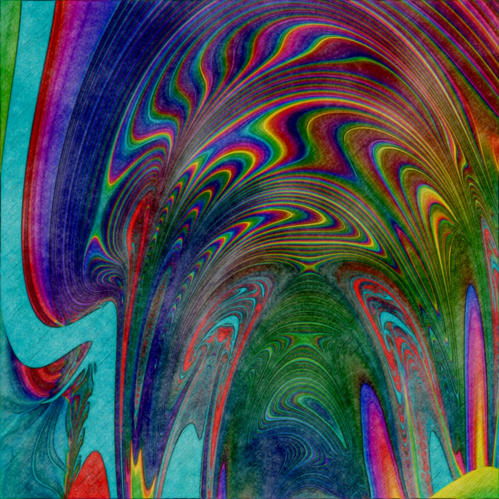
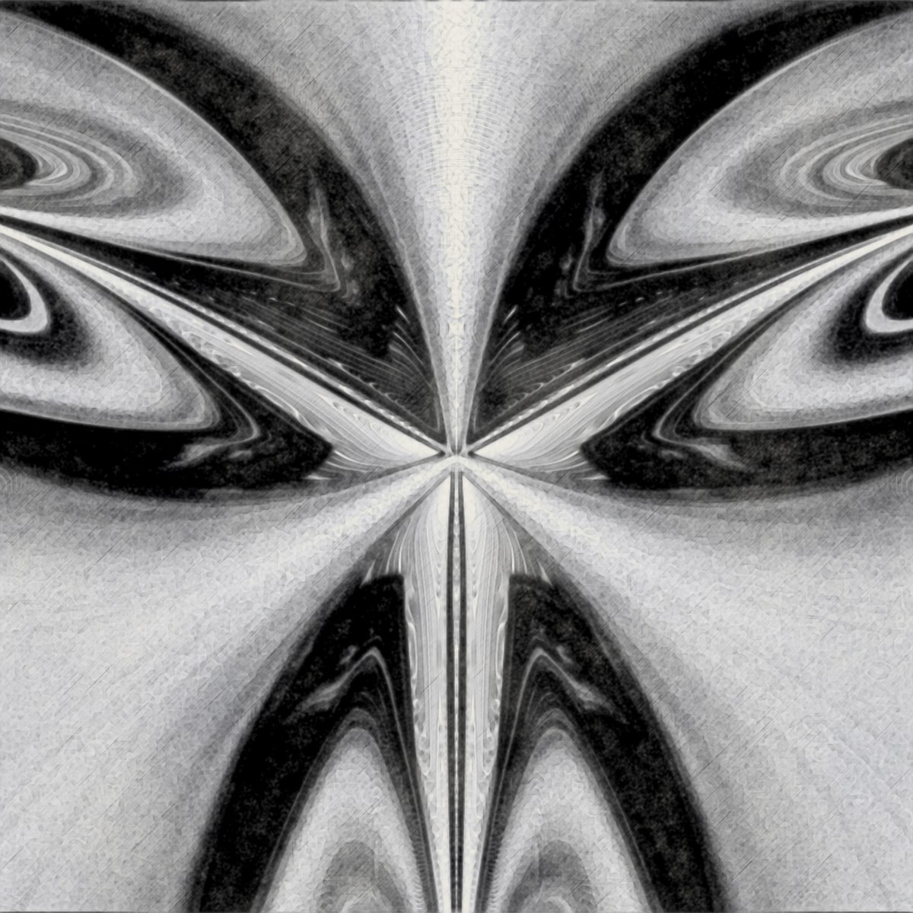
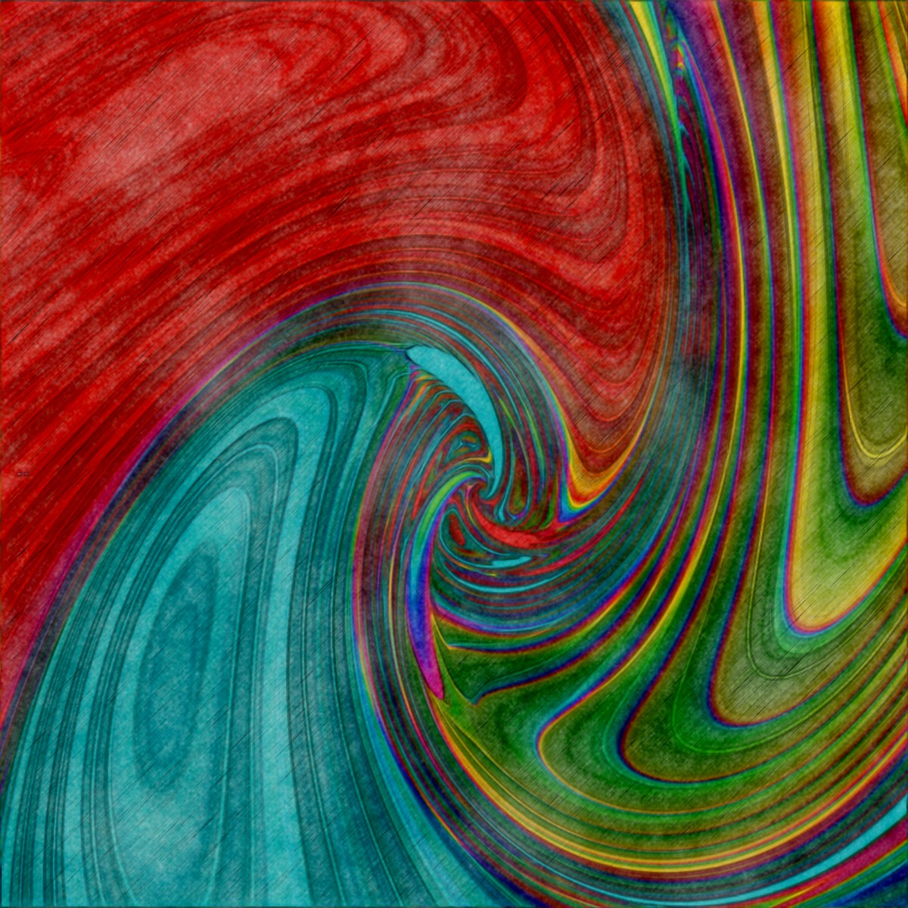
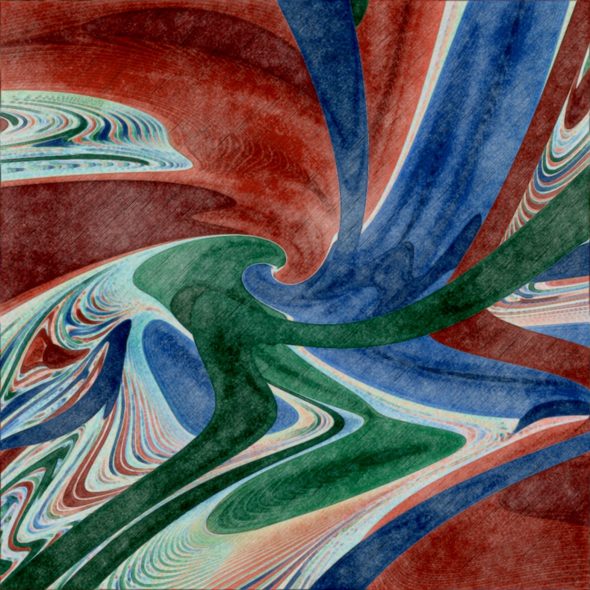
</p>
<p>
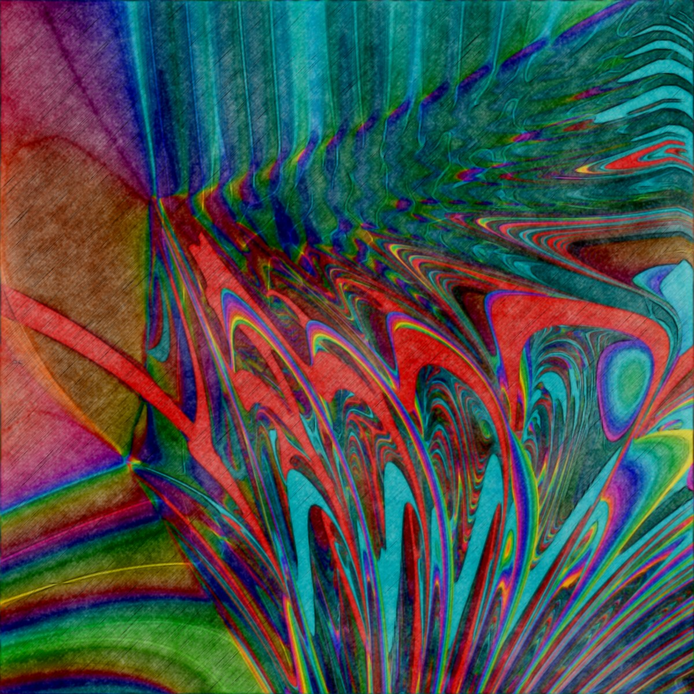
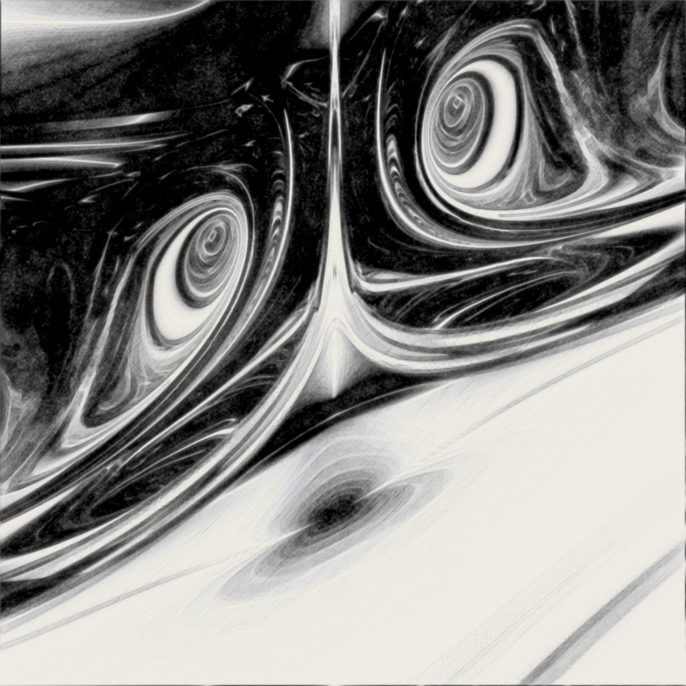
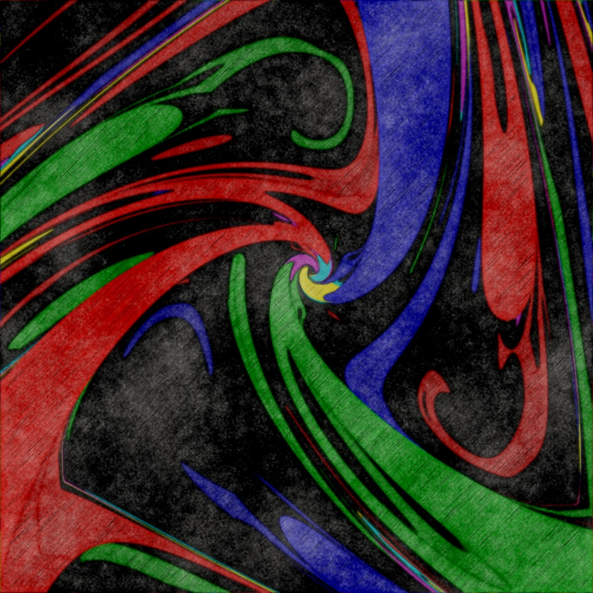
</p>

## What it is

Principia is a scientific instrument for exploring the initial-condition manifold of the planar three-body problem. It renders zoomable basin-boundary maps: pick a slice through the space, integrate every pixel's initial condition forward, classify how it ends, and colour it accordingly.

It is built to be used as both an instrument and a picture. The same view that makes a good image is one you can take measurements from.

## How it works

**A reduced space.** Translation, boost, rotation and scale are symmetries of the problem, and only the ratios of the masses matter, so initial conditions that differ only by one of these are the same physics. Quotienting them all out takes the fifteen numbers that describe three bodies (six positions, six velocities, three masses) down to an eight-dimensional space, and every point in it is a distinct starting configuration. Translation and boost go together: the centre-of-mass frame, with its origin riding along with the centre of mass, removes both at once. Energy and angular momentum are not fixed by the reduction: they vary across the manifold and can be chosen as chart axes. Scale and rotation are separate gauges, since they are physically different: rotation is a genuine symmetry reduction with a conserved momentum, while scale reflects the homogeneity of the potential.

<p>
<picture>
  <source media="(prefers-color-scheme: dark)" srcset="docs/readme/symmetry-reduction-dark.gif">
  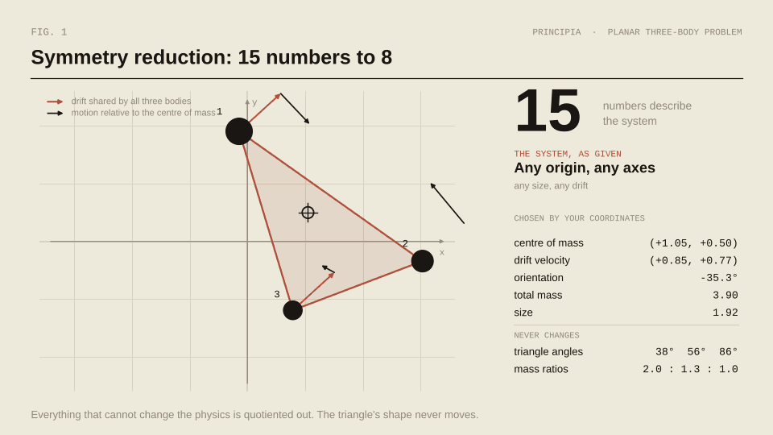
</picture>
</p>

**Slices and charts.** The screen shows a 2D slice through that space. The slice can be translated, rotated and tilted along any direction, using an axis-angle parametrisation so it never locks up at the poles. Chart axes can be set to latent dimensions, physical quantities such as energy or angular momentum, or the Burrau dimensions.

**Integration.** By default, each pixel is integrated with Heggie's global regularisation, stepped with fourth-order Runge–Kutta, so close encounters don't wreck the step size. Heggie regularisation outperformed Aarseth–Zare on 31 of the 32 benchmark cases.

Two clocks are involved. The first is regularised time: when bodies are close, each step of regularised time covers less physical time. Here the same integrator takes the same number of steps twice: with a fixed time step it overshoots every close pass, while with a regularised step it spends its steps where the action is. The animation shows the idea for a single pair, in a plain leapfrog; the global regularisation does the same for all three pairs at once.

<p>
<picture>
  <source media="(prefers-color-scheme: dark)" srcset="docs/readme/regularised-time-dark.gif">
  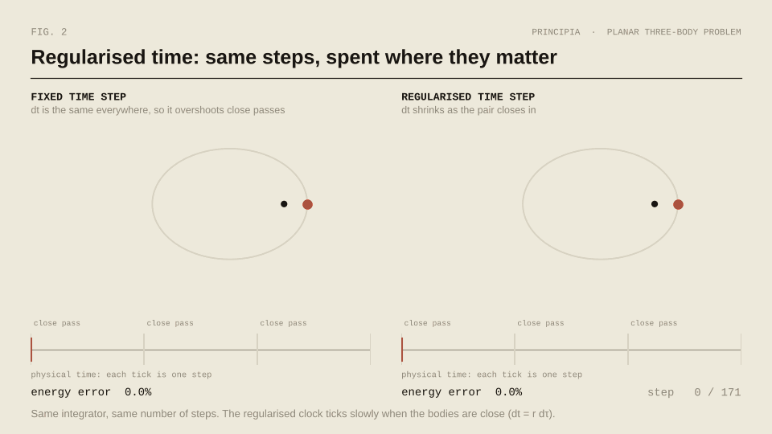
</picture>
</p>

The second is the time unit. Because scale is a gauge, time is measured in natural units, τ = √(L³ / GM) for a unit of length L and of mass M, and integration time maps back to real time for a system of any size and mass. Burrau's classic problem (masses 3, 4 and 5 at the corners of a 3-4-5 triangle, released from rest) shows it. Drawn as a Sun, Earth and Moon, or as a football, tennis ball and ping-pong ball, it is the same orbit: only the ratios of the masses and distances matter (the artwork is just artwork, and the real masses are nothing like 3 : 4 : 5). What differs is the clock, with one unit of time lasting 58 days at the scale of solar masses and AU, and 3.4 hours for a unit of 100 g and 10 cm.

<p>
<picture>
  <source media="(prefers-color-scheme: dark)" srcset="docs/readme/scale-time-dark.gif">
  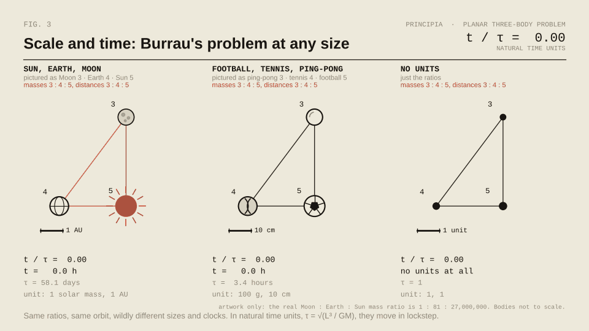
</picture>
</p>

**Classification.** An orbit is classed as an escape when its shape has stopped changing and the escaping body is unbound (shape-vector closure plus the sign of the energy). On the legacy validation set (ground truth taken at t = 30), measured before the current energy test was fixed, it gave 100% precision and 96.3% recall, against 97.9% precision for the earlier criterion; those figures are still to be re-validated. Separately, Chazy's final-motion classes (designed, not yet built) will record how the system ends up as time runs on: whether bodies separate, and which pair stays bound.

**Colouring.** Principia colours the manifold with a node graph rather than a fixed palette. Any property of an initial condition can drive it, whether that's how the system ends, how long it takes, or a conserved or dynamical quantity along the way, such as energy, angular momentum or the finite-time Lyapunov exponent. Shape is an input too: where a configuration sits on the shape sphere (the space of triangle shapes, with size and orientation factored out) can colour a point at the start or at any moment along its trajectory. The graph combines and remaps those signals into colour and brightness, and a composable post-process stage turns the result into the final image. The same slice can be read as a classification, a diagnostic, or a picture.

**Rendering.** A three-layer adaptive scheme (flat grid, tile cache, adaptive quadtree refinement) concentrates integration effort where the boundary actually is. The Lyapunov exponent is computed with a Benettin shadow trajectory.

## Features

<table>
<tr><td><b>Atlas</b></td><td><i>Browse the space of beginnings on the GPU, natively, or in the browser as the same app. Pan, zoom without end, and rotate or tilt the slice in any direction.</i></td></tr>
<tr><td><b>Charts</b></td><td><i>Flat slices, the shape sphere, Burrau's problem, or a chart built from any axes you choose.</i></td></tr>
<tr><td><b>Fate</b></td><td><i>Every point integrated forward, regularised through close encounters, until a body escapes, two collide, or time runs out.</i></td></tr>
<tr><td><b>Refinement</b></td><td><i>Samples go where fates change, and stay coarse where they don't.</i></td></tr>
<tr><td><b>Stain</b></td><td><i>A graph from what was measured to how it looks, printed in watercolour, pencil or ink. The data doesn't change, only the ink.</i></td></tr>
<tr><td><b>Inspector</b></td><td><i>Follow one beginning closely, at double precision, and watch its orbit.</i></td></tr>
<tr><td><b>Honesty</b></td><td><i>It shows where its precision runs out: open any point to watch its single- and double-precision orbits part, and when. Failed runs are kept and counted, never painted over.</i></td></tr>
<tr><td><b>Prints</b></td><td><i>Every image carries its own settings, so any view can be recreated from the picture alone.</i></td></tr>
<tr><td><b>Results</b></td><td><i>Browsing buys hypotheses; the batch job, run at full precision, buys results.</i></td></tr>
</table>

*Some of these are still on the way. See [Status](#status).*

## Validation

The plan is to hold the instrument to known results before trusting it for new ones: converged reference solutions of the Burrau problem, lifetime and outcome maps from the free-fall literature, published periodic orbits, and benchmark cases for the integrator and the classifier. Periodic orbits come from the [Three Body Orbits](https://threebodyorbits.com) atlas, used under CC BY 4.0 with the operator's permission (unpublished orbits are excluded), and from the published catalogues of the Belgrade, Sofia and Shanghai groups.

## Status

Principia is under active development. The foundations are laid, and the interface already runs against a stand-in engine.

<p>
<a href="plan/MILESTONES.md">
<picture>
  <source media="(prefers-color-scheme: dark)" srcset="https://raw.githubusercontent.com/Ma1achy/Principia/progress/progress-dark.png">
  
</picture>
</a>
</p>

- **Native app first.** A Rust application with a developer GUI built in egui, and the production interface to follow.
- **Web v1.** The full native app, running in the browser.
- **Web v2.** A later, purpose-built browser product.

Everything is built from a spec-driven plan, and the markdown specification in [`docs/`](docs/) is the authority for how the instrument should behave.

## Building

> Build and run instructions will go here once the first native release is ready.

```
cargo run --release
```

## Credits

Built by Malachy. Thanks to the operator of the Three Body Orbits atlas for permission to use their data for validation.

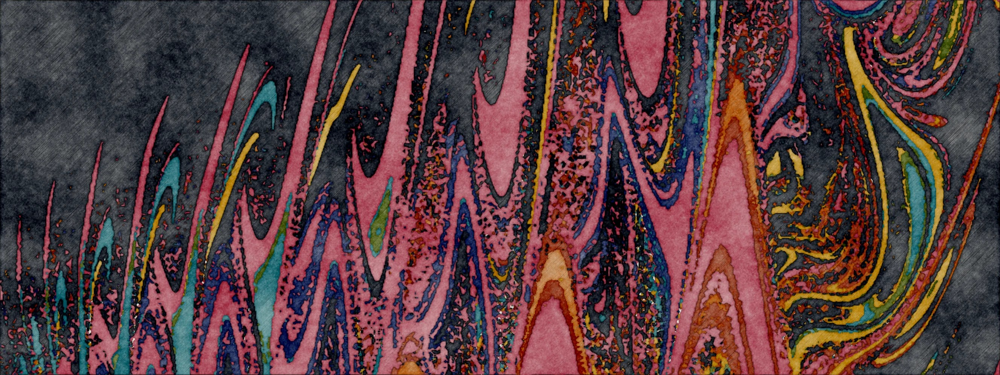

<p align="right">
<picture>
  <source media="(prefers-color-scheme: dark)" srcset="docs/readme/signature-dark.svg">
  
</picture>
</p>
